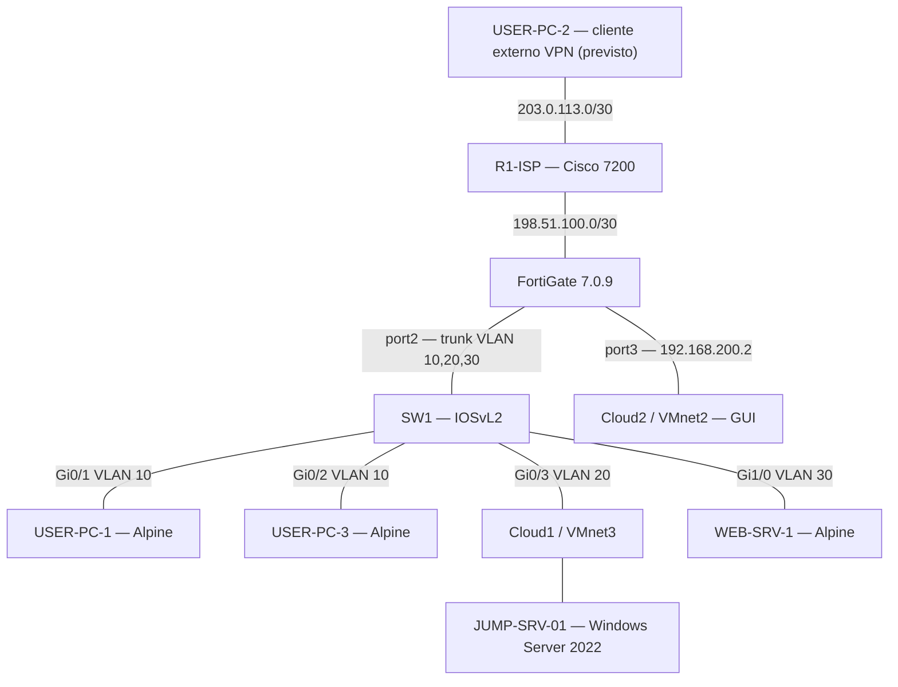

# Infraestructura 2 — Jump Server, VLAN, VPN y RemoteApp con FortiGate

## Video demostrativo

**https://youtu.be/ZyJbGNLJ6dE**

---

**Estudiante:** Oliver Eliam Aquino Paulino  
**Matrícula:** 2024-1571  
**Asignatura:** Seguridad de Redes  
**Entorno:** GNS3, Cisco IOS 7200 (ISP), Cisco IOSvL2 (SW1), FortiGate 7.0.9 (GUI), Alpine Linux, VMware Workstation y Windows Server 2022.

## Descripción

En esta práctica se diseñó una infraestructura con un **ISP simulado**, un firewall **FortiGate** y un **switch Cisco** encargado de separar usuarios y servidores. El **Jump Server**, implementado en Windows Server 2022, centraliza el acceso a aplicaciones mediante **Remote Desktop Services (RDS), RD Web y RemoteApp HTML5**.

La comunicación se controla con políticas que permiten **HTTPS desde la VLAN de usuarios al Jump Server**, restringen el acceso directo al servidor web y definen los servicios autorizados desde el Jump Server hacia el servidor web. También se configuró una **VPN IPsec de acceso remoto** para dirigir el acceso al Jump Server, aunque no se logró establecer el túnel durante la demostración.

## Objetivos

- Separar usuarios, Jump Server y servidor web en **VLAN 10, 20 y 30**.
- Proporcionar **DHCP** a los usuarios de la VLAN 10.
- Usar **FortiGate como gateway** y punto de aplicación de las políticas.
- Publicar aplicaciones desde **Windows Server 2022 con RemoteApp / RD Web HTML5**.
- Permitir acceso de usuarios a Jump Server por **HTTPS (443)** y bloquear los servicios no autorizados.
- Restringir el acceso directo de usuarios al servidor web.
- Definir desde Jump Server hacia Web únicamente **HTTPS (443), SSH (22) y RDP (3389)**.
- Preparar un acceso externo mediante **VPN IPsec** que alcance solamente los servicios definidos del Jump Server.
- Verificar qué componentes funcionan y documentar las pruebas pendientes.

## Topología

## Componentes

| Equipo | Función |
|---|---|
| R1-ISP | Simula el proveedor con enlaces /30 hacia FortiGate y el usuario externo |
| FortiGate VM64-KVM (7.0.9) | Enrutamiento entre VLAN, DHCP, políticas y túnel VPN IPsec |
| SW1 (IOSvL2) | Trunk 802.1Q, VLAN 10/20/30, Rapid-PVST y seguridad de puertos |
| USER-PC-1 / USER-PC-3 | Clientes Alpine Linux de VLAN 10 |
| USER-PC-2 | Equipo remoto destinado a probar la VPN |
| JUMP-SRV-01 | Windows Server 2022 con dominio `redes.test`, IIS, RDS, RD Web y RemoteApp |
| WEB-SRV-1 | Servidor Alpine en VLAN 30; conectividad y servicios pendientes de validar |

## Direccionamiento

| Segmento / equipo | Dirección | Función |
|---|---|---|
| R1 hacia FortiGate (Fa0/0) | `198.51.100.1/30` | ISP simulado |
| FortiGate port1 (WAN-ISP) | `198.51.100.2/30` | Salida hacia ISP |
| R1 hacia cliente remoto (Fa1/0) | `203.0.113.1/30` | Enlace del cliente VPN |
| Cliente VPN externo | `203.0.113.2/30` | Dirección prevista, no verificada |
| VLAN 10 | `10.15.71.0/25` | Usuarios |
| FortiGate VLAN 10 | `10.15.71.1/25` | Gateway y DHCP |
| USER-PC-1 | `10.15.71.2/25` | Dirección observada por DHCP |
| VLAN 20 | `10.15.71.128/29` | Jump Server |
| FortiGate VLAN 20 | `10.15.71.129/29` | Gateway |
| JUMP-SRV-01 (Ethernet1) | `10.15.71.130/29` | Servidor Windows |
| VLAN 30 | `10.15.71.136/29` | Servidor Web |
| FortiGate VLAN 30 | `10.15.71.137/29` | Gateway |
| WEB-SRV-1 | `10.15.71.138/29` | Dirección prevista |
| Pool de VPN | `10.15.72.10–10.15.72.30` | Clientes VPN |
| FortiGate port3 | `192.168.200.2/24` | Administración GUI |
| Jump Ethernet0 (VMnet8) | `192.168.53.10/24` | NAT auxiliar de la VM durante las pruebas |

**DHCP en VLAN 10:** rango `10.15.71.2–10.15.71.126`; gateway `10.15.71.1`; DNS `10.15.71.130`. Las redes 198.51.100.0/24 y 203.0.113.0/24 se usan aquí como **direcciones de documentación**, no como direcciones públicas en Internet.

## Cisco — ISP y switch

**R1-ISP:** Fa0/0 `198.51.100.1/30` y Fa1/0 `203.0.113.1/30`, ambas interfaces observadas `up/up`. Tiene rutas estáticas hacia `10.15.71.0/25`, `10.15.71.128/29` y `10.15.71.136/29` a través de `198.51.100.2`. Las rutas aparecen instaladas en `show ip route`.

**SW1:** Gi0/0 opera como **trunk 802.1Q**, con VLAN 10, 20 y 30 activas. Gi0/1 y Gi0/2 están en **VLAN 10** con Port-Security (máximo 2 MAC, modo `restrict`), PortFast y BPDU Guard. Gi0/3 corresponde a **VLAN 20 / Jump Server** y Gi1/0 a **VLAN 30 / Web Server**. Está habilitado **Rapid-PVST**.

Las configuraciones relevantes, **sin hashes ni contraseñas**, se encuentran en [running-configs/](running-configs/).

## FortiGate — Interfaces y políticas

El equipo se administró mediante **GUI**, accesible en el laboratorio a través de `http://192.168.200.2`. Las interfaces VLAN cuelgan de `port2`; la WAN utiliza `port1`.

| Política | Origen → destino | Acción |
|---|---|---|
| `ALLOW-USERS-JUMP` | VLAN 10 → Jump | Permite DNS y HTTPS |
| `DENY-NORMAL-SSH-JUMP` | Usuario normal → Jump | Deniega SSH |
| `DENY-USERS-JUMP-OTHER` | VLAN 10 → Jump | Deniega otros servicios |
| `DENY-NORMAL-SSH-WEB` | Usuario normal → Web | Deniega SSH |
| `DENY-USERS-WEB-DIRECT` | VLAN 10 → Web | Deniega acceso directo |
| `ALLOW-JUMP-WEB` | Jump → Web | Permite HTTPS, SSH y RDP-3389 |
| `DENY-JUMP-WEB-OTHER` | Jump → Web | Deniega otros servicios |
| `VPN-ALLOW-JUMP` | Pool VPN → Jump | Permite DNS y HTTPS |
| `VPN-DENY-JUMP-OTHER` | Pool VPN → Jump | Deniega los demás servicios |

La política automática del asistente VPN `vpn_VPN-JUMP_remote_0`, que permitía `ALL`, **quedó deshabilitada** en el respaldo. Se mantiene el **Implicit Deny** al final.

## Windows Server — RDS / RemoteApp

En `JUMP-SRV-01.redes.test` se preparó el dominio `redes.test`, los servicios de escritorio remoto y el acceso mediante navegador.

**Cliente web HTML5:**

`https://JUMP-SRV-01.redes.test/RDWeb/webclient/index.html`

Se obtuvo acceso a la página de inicio de sesión y a la vista **Work Resources** de RD Web. El laboratorio contempló un usuario normal y otro privilegiado, con aplicaciones publicadas según el usuario. Las capturas conservadas muestran el portal y una vista de aplicaciones; **no verifican por sí solas todas las restricciones individuales**.

Durante las pruebas, Windows tenía dos adaptadores: NAT auxiliar `192.168.53.10` y red de laboratorio `10.15.71.130`. Para permitir el retorno del tráfico hacia VLAN 10 se configuró una ruta persistente vía `10.15.71.129`, utilizando la interfaz de la red de laboratorio.

## VPN IPsec

En FortiGate se creó el túnel **`VPN-JUMP`**, ligado a WAN `port1`, con asignación de IPs `10.15.72.10–10.15.72.30` y split tunnel destinado al Jump Server.

**Estado de demostración:** en las capturas el túnel figura **Inactive**. Por tanto, existe configuración de VPN, pero **no se documenta una conexión remota exitosa**. Los parámetros heredados del asistente son propios de un laboratorio y requieren endurecimiento antes de cualquier uso productivo.

## Pruebas realizadas y resultados

| Prueba | Evidencia / resultado |
|---|---|
| Trunk y VLAN en SW1 | **Verificado:** trunk Gi0/0 activo con VLAN 10/20/30; puertos access asignados |
| ISP | **Verificado:** Fa0/0 y Fa1/0 `up/up`; rutas conectadas y estáticas presentes |
| DHCP USER-PC-1 | **Verificado:** IP observada `10.15.71.2/25` |
| USER-PC-1 → Jump por HTTPS | **Verificado:** `wget` recibió `HTTP/1.1 302 Found` y luego `HTTP/1.1 200 OK` en `10.15.71.130:443` |
| FortiGate | **Verificado:** interfaces y políticas presentes en GUI y en respaldo |
| RD Web / RemoteApp | **Verificado parcialmente:** portal de inicio de sesión y vista de recursos accesibles |
| Bloqueos SSH / Web | Políticas configuradas; el simple timeout no sustituye la verificación mediante registros |
| Jump → WEB-SRV-1 | **No validado:** las conexiones TCP de prueba no tuvieron éxito |
| WEB-SRV-1 → gateway VLAN 30 | **No validado:** la resolución ARP hacia `10.15.71.137` falló |
| VPN cliente externo → Jump | **No validado:** túnel `VPN-JUMP` inactivo |

## Archivos del repositorio

### Configuraciones relevantes (sanitizadas)
- [R1-ISP — interfaces y rutas verificadas](running-configs/R1-ISP_configuracion_relevante.txt)
- [SW1 — extracto de running-config](running-configs/SW1_configuracion_relevante.txt)
- [FortiGate — interfaces, DHCP, políticas y VPN](running-configs/FortiGate_configuracion_relevante_SANITIZADA.conf)

### Scripts y documentación técnica
- [Comandos de pruebas](scripts/Comandos_Pruebas_Jump_Server.txt)
- [Direccionamiento y puertos](scripts/Direccionamiento_y_Puertos_Jump_Server.txt)
- [Windows Server y RemoteApp](scripts/Windows_Server_RemoteApp.md)
- [Explicación de resultados y pendientes](scripts/Explicacion_y_Pruebas_Jump_Server.md)

**Nota de publicación:** se omiten contraseñas, hashes, claves de VPN y respaldos completos con secretos. Estos archivos son **extractos de documentación**, no copias restaurables.

## Conclusión

La práctica permitió configurar y verificar la segmentación de VLAN, el enrutamiento del ISP, las políticas del FortiGate y el acceso HTTPS desde un usuario Alpine al Jump Server Windows. También se configuraron servicios RDS/RemoteApp y una VPN IPsec cuyo establecimiento remoto quedó pendiente. La conexión al servidor web de VLAN 30 no se validó; este resultado se conserva para no confundir una regla de firewall existente con un servicio funcionando.

**Video:** https://youtu.be/ZyJbGNLJ6dE
